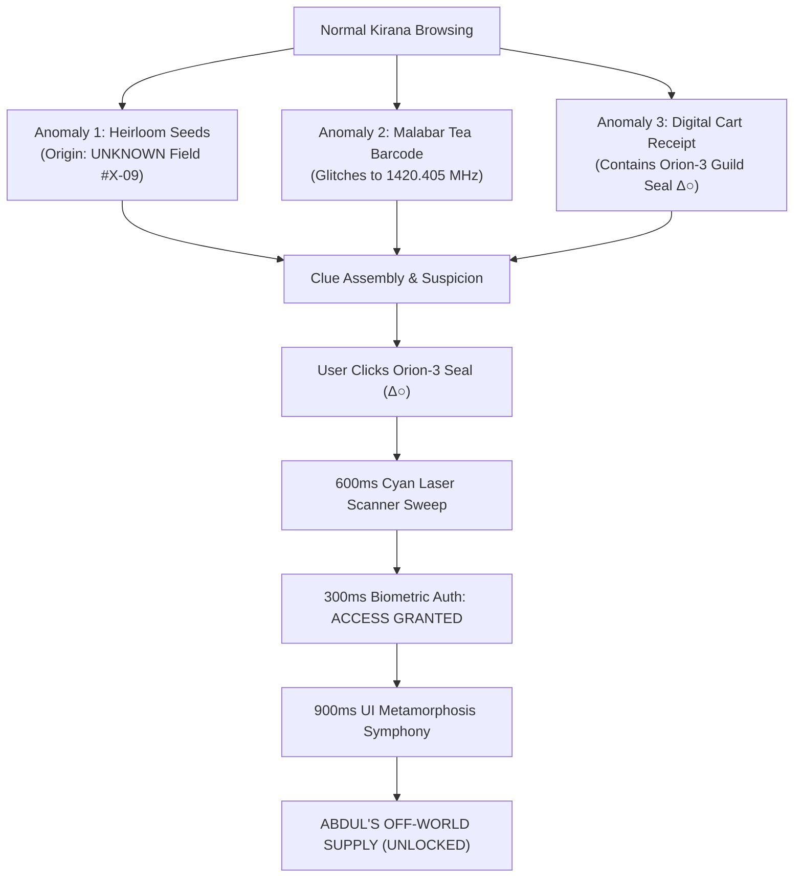

# ROUND 1 — SECRET FEATURE ARCHITECTURE: "THE OTHER SIDE"
**Project:** ABDUL'S GENERAL STORE / ABDUL'S OFF-WORLD SUPPLY  
**Scope:** Discovery Mechanics, Anomaly Clues, 900ms Metamorphosis, A11y Alternative  
**Version:** v0.1 — Implementation Contract  

---

## 1. Discovery Philosophy

The secret feature is the central competition differentiator. It is engineered as a **reward for user curiosity**, embedded directly within the physical artifacts of an Indian Kirana store.



---

## 2. The 4 Multi-Stage Anomaly Clues

| Clue # | Location | Surface Appearance | Uncovered Secret | Trigger / Interaction |
| :--- | :--- | :--- | :--- | :--- |
| **Clue 1** | *Heirloom Seeds* Card | Standard seed packet pill | `ORIGIN: UNKNOWN (Field #X-09)` | Hover / Click opens lore tooltip: *"Cultivated under triple star illumination"* |
| **Clue 2** | *Malabar Tea* Packaging | Standard EAN-13 Barcode | `LAT 28.6507° N, 1420.405 MHz` | Hovering over barcode causes digits to flicker with radio frequency static |
| **Clue 3** | Digital Cart Receipt | Standard tax invoice footer | Faint terracotta Orion-3 seal: `[Δ○ Outpost #07]` | Seal pulses cyan when cart items are modified |
| **Clue 4** | Store Wordmark Sign | Hand-painted Kirana sign | Microscopic `Δ○` in the apostrophe of `ABDUL'S` | Clicking the seal on the receipt or wordmark activates the scanner |

---

## 3. The Sensory & Interactive Sequence

### What the User Sees:
- Subtle visual anomalies that do not break the store's realism.
- A glowing cyan seal that reacts to cursor proximity.
- A full-screen vertical laser sweep during authentication.
- Real-time transition from warm cream paper to deep cosmic navy.

### What the User Clicks:
- The Orion-3 Guild seal (`Δ○`) located on the printed cart receipt or product detail modal.

### What the User Hears (Web Audio API / Synthesized):
- A soft, warm 432Hz ambient sub-space frequency hum during scanning.
- A crisp electronic confirmation chime upon `ACCESS GRANTED`.

### What Changes:
- **Color Palette:** `#F5F0E6` (Cream) $\rightarrow$ `#070B18` (Cosmic Void).
- **Store Name:** `ABDUL'S GENERAL STORE` $\rightarrow$ `ABDUL'S OFF-WORLD SUPPLY`.
- **Product Grid:** Grocery items $\rightarrow$ Extraterrestrial artefacts.
- **Currency:** Indian Rupees (`₹`) $\rightarrow$ Galactic Credits (`G₵`).
- **Cart Drawer:** Grocery basket $\rightarrow$ Interstellar Cargo Manifest.

### What Remains:
- Navigation structure and search bar position.
- Cart items and quantities (stored in memory).
- Visual layout grid (split hero and 4-column card format).

---

## 4. The 900ms Metamorphosis Choreography

```typescript
export const MetamorphosisTimeline = [
  { time: '0ms - 150ms',   action: 'Lock pointer events; apply 1.5px backdrop blur to normal UI' },
  { time: '150ms - 350ms', action: 'Shift CSS variables: --color-bg-primary transforms #F5F0E6 -> #070B18' },
  { time: '350ms - 550ms', action: 'Signage 3D flip 180deg (X-axis): Storefront swaps to Off-World Supply' },
  { time: '550ms - 750ms', action: 'Product cards stagger-flip, revealing titanium crate borders and cyan seams' },
  { time: '750ms - 900ms', action: '3D model lighting shifts from 3200K warm studio to cyan/purple nebula glow' },
  { time: '900ms',         action: 'Unlock pointer events; render Off-World Supply fully interactive' }
];
```

---

## 5. Edge Cases & Accessibility Fallback

1. **What if the user misses all clues?**
   - The store remains 100% useful as a complete Indian Kirana e-commerce prototype.
   - In the footer store story section, a subtle expandable note reads: *"Looking for our night ledger? Check your delivery receipt."*
2. **What if the user clicks the wrong element?**
   - No penalty, error state, or disruptive modal. Regular elements perform their expected grocery store action.
3. **Accessible Non-Visual Alternative:**
   - In the cart drawer, an accessible semantic button with `aria-label="Decrypt extraterrestrial supply manifest"` is available for keyboard and screen-reader users, triggering the transformation cleanly without requiring visual hunting.

---
*End of Secret Feature Specification — Pixelcraft Armory Round 1*
