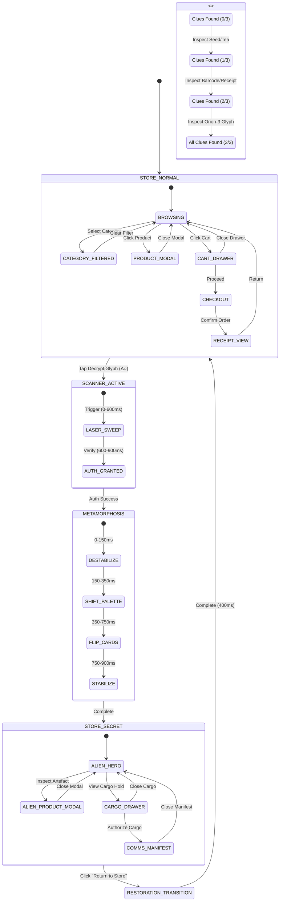

# ROUND 1 — FINITE STATE MACHINE & SYSTEM STATE SPECIFICATION
**Project:** ABDUL'S GENERAL STORE / ABDUL'S OFF-WORLD SUPPLY  
**Scope:** Mathematical State Graph, Discovery Counters, Edge Case Recovery  
**Version:** v0.1 — Implementation Contract  

---

## 1. Top-Level State Machine Diagram

The application operates as a **Deterministic Finite Automaton (DFA)** with two primary operational modes linked by a guarded transformation bridge:



---

## 2. Formal State Definitions

### 2.1 Normal Mode States (`STORE_NORMAL`)

| State ID | Description | Active Modals / Drawers | Allowed Events |
| :--- | :--- | :--- | :--- |
| `IDLE_BROWSING` | Standard storefront catalog | None | `CLICK_PRODUCT`, `ADD_CART`, `SEARCH`, `OPEN_CART`, `DISCOVER_CLUE` |
| `PRODUCT_INSPECT` | Normal product modal open | `Modal: ProductDetail` | `CLOSE_MODAL`, `ADD_CART_QTY`, `ZOOM_BARCODE`, `DISCOVER_CLUE` |
| `CART_ACTIVE` | Normal cart drawer open | `Drawer: Cart` | `CLOSE_DRAWER`, `UPDATE_QTY`, `REMOVE_ITEM`, `GO_CHECKOUT`, `TAP_RECEIPT_STAMP` |
| `CHECKOUT_FLOW` | Order placement modal | `Modal: Checkout` | `CANCEL_CHECKOUT`, `SUBMIT_ORDER` |
| `RECEIPT_ACTIVE` | Digital thermal slip open | `Modal: Receipt` | `CLOSE_RECEIPT`, `PRINT_RECEIPT`, `TAP_ORION_GLYPH` |

### 2.2 Transition States (`TRANSITION`)

| State ID | Duration | Interactive Lock | Animation Phase |
| :--- | :--- | :--- | :--- |
| `SCANNER_SWEEP` | 600ms | Yes (`pointer-events: none`) | Vertical cyan laser bar descending with 432Hz hum |
| `AUTH_CONFIRM` | 300ms | Yes | Terminal text displays `ACCESS GRANTED: OUTPOST #07` |
| `UI_METAMORPHOSIS`| 900ms | Yes | Staggered 3D card-flip; background shifts `#F5F0E6` $\rightarrow$ `#070B18` |
| `RESTORATION` | 400ms | Yes | Gentle cross-fade restoring normal store palette and layout |

### 2.3 Secret Mode States (`STORE_SECRET`)

| State ID | Description | Active Modals / Drawers | Allowed Events |
| :--- | :--- | :--- | :--- |
| `ALIEN_IDLE` | Off-World Supply storefront | None | `CLICK_ARTEFACT`, `BEAM_CARGO`, `OPEN_CARGO`, `EXIT_SECRET` |
| `ARTEFACT_INSPECT`| Cosmic detail modal open | `Modal: AlienDetail` | `CLOSE_MODAL`, `BEAM_QTY`, `READ_ORBITAL_LORE` |
| `CARGO_ACTIVE` | Interstellar cargo drawer | `Drawer: CargoHold` | `CLOSE_DRAWER`, `CLEAR_CARGO`, `AUTHORIZE_MANIFEST` |
| `MANIFEST_ACTIVE` | Classified trade log modal | `Modal: CommsManifest` | `CLOSE_MANIFEST`, `READ_1979_LOGS` |

---

## 3. Parallel Discovery Register & Clue Counters

The system maintains a lightweight clue state register:

```typescript
export interface DiscoveryState {
  cluesFound: {
    seedOrigin: boolean;    // Discovered unknown seed origin
    teaBarcode: boolean;    // Discovered radio frequency on tea barcode
    receiptStamp: boolean;  // Discovered Orion-3 guild glyph on receipt
  };
  totalCluesDiscovered: number; // 0 to 3
  isSecretUnlocked: boolean;    // True once scanner successfully passes
  currentMode: 'normal' | 'scanning' | 'transforming' | 'secret';
}
```

- **Clue Progression Logic:**
  - Finding 1 clue $\rightarrow$ Audio feedback chime + subtle HUD indicator.
  - Finding 2 clues $\rightarrow$ Barcode coordinates link with receipt stamp.
  - Finding 3 clues or clicking the Orion-3 glyph $\rightarrow$ Unlocks the Scanner trigger immediately.

---

## 4. Error, Interruption & Edge Case Handling

1. **Browser Refresh / Reload:**
   - State is preserved in `sessionStorage` (`key: "abduls_store_state"`).
   - If the user was in `STORE_SECRET`, refreshing keeps them in `STORE_SECRET` without needing to re-solve the clues.
2. **Interrupted Transition (Tab Switch / Window Blur):**
   - The 900ms Framer Motion animation uses deterministic keyframes; upon returning focus, the system automatically settles into the target final state (`STORE_SECRET` or `STORE_NORMAL`).
3. **Double Click / Spam Click:**
   - The trigger event sets an internal debounce lock (`isTransitioning = true`), preventing repeated state triggers.
4. **Local State Corruption:**
   - If `sessionStorage` contains invalid JSON, the state machine safely falls back to default `STORE_NORMAL` with an empty cart.
5. **Reduced Motion Mode (`prefers-reduced-motion: reduce`):**
   - Disables the 3D card flips and laser sweep; replaces them with a smooth, instant 200ms opacity cross-fade.

---
*End of State Machine Specification — Pixelcraft Armory Round 1*
