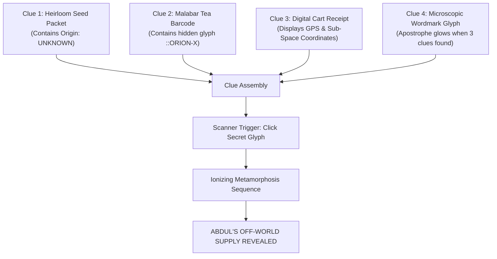

# ROUND 1 — CREATIVE BRIEF, BRAND SYSTEM & CONCEPT DEFINITION
**Project:** ABDUL'S GENERAL STORE / ABDUL'S OFF-WORLD SUPPLY  
**Competition:** Pixelcraft Competition — Round 1  
**Author / Team:** Pixelcraft Armory  
**Document Version:** v0.1 — Implementation-Ready Creative Architecture  
**Date:** March 2026  

---

## 01. Project Identity

- **Primary Brand Name:** ABDUL'S GENERAL STORE
- **Secondary / Classified Identity:** ABDUL'S OFF-WORLD SUPPLY
- **Primary Tagline:** *"Daily Needs. Otherworldly Secrets."*
- **Supporting Narrative Tagline (Contextual):** *"One small store. More worlds than you know."*
- **Store Foundation:** Established in 1979 in a bustling neighbourhood lane, serving local daily essentials while quietly acting as Earth's primary subterranean rendezvous point for extraterrestrial wayfarers and interstellar merchants.

---

## 02. Competition Cards & Constraints

The concept harmoniously synthesizes all three mandatory competition constraints without friction:

| Constraint Card | Mandatory Requirement | Creative Execution |
| :--- | :--- | :--- |
| **BUSINESS CARD** | **ABDUL GENERAL STORE** | An authentic, warm, community-rooted Indian neighbourhood Kirana store with daily essentials, grains, spices, milk, snacks, handwritten price receipts, and INR (₹) pricing. |
| **THEME CARD** | **ALIENS** | A secretive cosmic supply-chain layer operating behind the store counters; alien artefacts masquerading as mundane grocery packaging; interplanetary trade logs hidden beneath delivery receipts. |
| **WILD CARD** | **ADD A SECRET FEATURE** | **"THE OTHER SIDE"** (Abdul's Secret Store): An organic, non-obvious discovery journey where observant shoppers spot recurring cosmic glyph anomalies, decode coordinates on a digital receipt, and trigger a complete visual and functional UI metamorphosis into *Abdul's Off-World Supply*. |

---

## 03. Concept Statement

> **"An Indian neighbourhood Kirana store that has secretly been supplying extraterrestrial visitors since 1979."**

At first glance, the digital experience presents an authentic, trustworthy Indian Kirana storefront. Shoppers browse daily essentials—A2 milk pouches, basmati rice, roasted snacks, chai leaves, cold beverages, and household detergents—priced in Indian Rupees (₹), complete with an interactive cart drawer and friendly neighbourhood store hours.

However, beneath the familiar surface lies a web of subtle anomalies: an unlisted origin code on a turmeric pack, a barcode that hums with classified coordinates, a faded alien glyph stamped onto paper receipts, and unverified batch numbers. 

When the user discovers and interacts with the hidden clues, the familiar store undergoes a seamless, tactile metamorphosis into **"Abdul's Off-World Supply"**—revealing cosmic energy canisters, memory seed pods, orbital telemetry items, and classified trade logs priced in Galactic Credits ($G\mathbb{C}$).

---

## 04. Story & Narrative Universe

### The Backstory
In the autumn of 1979, during the installation of a deep cold-storage cellar beneath his newly opened corner store in Old Delhi, Abdul made first contact with an interstellar trading vessel that made an unscheduled descent. Rather than panicking, Abdul—a pragmatic shopkeeper with a golden heart—offered them a cup of cardamom chai and a tin of butter biscuits. 

Recognizing Abdul’s discretion, warmth, and legendary procurement skills, the extraterrestrial confederation designated his store as **Terran Resupply Outpost #07**.

For nearly five decades, Abdul has maintained dual ledgers:
1. **The Day Ledger:** Supplying mustard oil, pulses, fresh bread, and laundry soap to generations of neighbourhood families.
2. **The Night Ledger:** Procuring cosmic plasma capacitors, sub-space seed pods, moon milk, and starlight distillates for off-world travellers passing through Sector Orion-3.

### The Narrative Arc in the UI
1. **Familiarity:** The user arrives looking for daily groceries.
2. **Curiosity:** Strange details catch the eye—a product marked `ORIGIN: UNKNOWN`, a receipt printing galactic coordinates.
3. **Suspicion:** A recurring triangular cosmic glyph appears in three disparate places.
4. **Discovery:** Interacting with the anomaly triggers a biometric/scanner verification sequence.
5. **Surprise & Transformation:** The interface gracefully peels back its Kirana skin, shifting into the cosmic dark room of Abdul's Off-World Supply.
6. **Exploration:** The user shops for planetary artefacts and reads Abdul's secret transmission log.
7. **The Payoff:** A closing realization that Abdul never left Earth—he brought the galaxy to his corner store.

---

## 05. Brand Personality

Abdul's Store is designed to feel like an endearing neighbourhood uncle who happens to hold the keys to the universe.

- **Warm & Welcoming:** Earthy, generous, deeply rooted in Indian hospitality.
- **Clever & Discreet:** Subtle wit, hidden easter eggs, intelligent clues that respect user curiosity.
- **Nostalgic & Authentic:** Evoking the tactile charm of Indian shop counters, glass jars, brass weights, and paper bills.
- **Mysterious & Playful:** A sense of cosmic wonder without dread or cosmic horror.
- **Trustworthy:** Transparent pricing, clear product specs, high functional utility.

### Anti-Personas (What We Avoid)
- **NOT Dark Cosmic Horror:** No terrifying Eldritch monsters or biomechanical parasites.
- **NOT Generic Neon Cyberpunk:** No gratuitous neon glare, chrome grids, or dystopian tropes.
- **NOT Overly Childish:** No goofy cartoon mascots or shallow novelty gags.
- **NOT Corporate / Sterile:** No bland Scandinavian minimalism that erases the store's cultural soul.

---

## 06. Visual Direction

The visual architecture seamlessly blends **Indian Kirana Heritage** with **Retro Sci-Fi & Modern Tactile UI**:

```
┌──────────────────────────────────────────────────────────┐
│                   VISUAL DIRECTION HYBRID                │
├─────────────────────────────┬────────────────────────────┤
│     INDIAN KIRANA LAYER     │     RETRO SCI-FI LAYER     │
├─────────────────────────────┼────────────────────────────┤
│ • Warm cream paper textures │ • Deep interstellar navy   │
│ • Forest green shop trim    │ • Muted cosmic purple      │
│ • Terracotta & turmeric     │ • Luminescent alien green  │
│ • Glass candy jars & scales │ • Sub-space vector glyphs  │
│ • Printed perforated slips  │ • Monospace telemetry data │
│ • Physical cardboard boxes  │ • Weightless floating 3D   │
└─────────────────────────────┴────────────────────────────┘
                              │
                              ▼
        PREMIUM, POLISHED DUAL-STATE DIGITAL INTERFACE
```

---

## 07. Full Dual Color Palette System

The system operates across two coordinated token systems that transition logically rather than clashing.

### Layer 1: Normal Store Palette (Warm Kirana)

| Token Name | Hex Code | Semantic Role & Application |
| :--- | :--- | :--- |
| `store-bg-primary` | `#F5F0E6` | Primary background; unbleached shop paper & warm parchment |
| `store-bg-surface` | `#FFF9EF` | Card surfaces, container elevation, modal bodies |
| `store-green-deep` | `#173F35` | Primary brand accent; traditional shop shutters, header trim |
| `store-green-secondary` | `#2D6652` | Secondary badges, active filters, hover accents |
| `store-terracotta` | `#C66B4A` | Category badges, warm highlight pill, sale tags |
| `store-red-warm` | `#A94335` | Urgent notices, primary CTA accent, spice category tag |
| `store-yellow-warm` | `#E8B94F` | Star ratings, festive highlight borders, turmeric tags |
| `store-text-dark` | `#1C2421` | High-contrast body text, headings, primary pricing |
| `store-text-muted` | `#6F756F` | Secondary metadata, weight units, subtitles |
| `store-border` | `#D8D0C1` | Card outlines, dividers, perforated receipt borders |

### Layer 2: Alien / Secret Palette (Off-World Supply)

| Token Name | Hex Code | Semantic Role & Application |
| :--- | :--- | :--- |
| `alien-bg-deep` | `#070B18` | Deep cosmos void background |
| `alien-bg-surface` | `#0D1630` | Interstellar cargo crate surfaces, elevated panels |
| `alien-purple-cosmic` | `#4B2A73` | Deep sub-space container borders, nebula gradients |
| `alien-green-luminescent`| `#A8FF60` | Holographic glyph highlights, active alien status, telemetry |
| `alien-cyan-electric` | `#52E5FF` | Scanning beams, sub-space frequencies, primary secret CTA |
| `alien-violet-soft` | `#9D7CFF` | Secondary energy aura, classification badges |
| `alien-white` | `#F1F5FF` | High-readability header text, holographic labels |
| `alien-border` | `#26375F` | Reinforced titanium frame borders, structural grid lines |
| `alien-text-muted` | `#DDE7FF` | Classified metadata, planetary origin coordinates |

---

## 08. Typography System

The typographic hierarchy bridges authentic editorial warmth with precision telemetry:

- **Display & Headlines:** `Space Grotesk` (Geometric, quirky, strong retro-futuristic character).
- **Body & Functional UI:** `Inter` / `Manrope` (Ultra-clean legibility, rhythmic spacing).
- **Coordinates & Secret Telemetry:** `JetBrains Mono` / `Space Mono` (Fixed-width for barcodes, batch codes, orbital angles, and receipt headers).

### Typographic Scale

| Level | Font Family | Weight | Size (px/rem) | Line Height | Tracking | Application |
| :--- | :--- | :--- | :--- | :--- | :--- | :--- |
| **Display** | Space Grotesk | 800 (Extrabold) | 48px / 3.0rem | 1.1 | -0.03em | Hero banner, transformed store reveal |
| **H1** | Space Grotesk | 700 (Bold) | 36px / 2.25rem | 1.2 | -0.02em | Section titles, drawer headings |
| **H2** | Space Grotesk | 600 (Semibold) | 24px / 1.5rem | 1.3 | -0.01em | Product names, bento card headers |
| **H3** | Manrope | 600 (Semibold) | 18px / 1.125rem| 1.4 | 0em | Sub-cards, modal headers |
| **Body Large**| Manrope | 400 (Regular) | 16px / 1.0rem | 1.6 | 0em | Product descriptions, store story |
| **Body Small**| Manrope | 400 (Regular) | 14px / 0.875rem| 1.5 | 0em | Specifications, ingredients list |
| **Price** | Space Grotesk | 700 (Bold) | 20px / 1.25rem | 1.0 | -0.01em | INR / Galactic Credit pricing |
| **Mono / Code**| JetBrains Mono | 500 (Medium) | 12px / 0.75rem | 1.4 | +0.05em | Batch codes, coordinates, origin |
| **Micro-Label**| Manrope | 700 (Bold) | 10px / 0.625rem| 1.2 | +0.08em | Category pills, origin badges |

---

## 09. Logo & Wordmark Direction

### Primary Wordmark (Normal State)
```
  ┌──────────────────────────────────────────────┐
  │              ESTD.       1979                │
  │     A B D U L ' S                            │
  │     G E N E R A L   S T O R E                │
  │       [Daily Needs • Kirana & Provisions]    │
  └──────────────────────────────────────────────┘
```
- **Visual Style:** Bold block typography with deep green framing, subtle gold inline rule, and authentic hand-painted store signage aesthetics.
- **The Secret Micro-Detail:** Embedded within the apostrophe of `ABDUL'S` is a microscopic inverted equilateral triangle containing a concentric circle—the universal trade mark of the Orion-3 Merchant Guild.

### Transformed Wordmark (Secret State)
```
  ┌──────────────────────────────────────────────┐
  │              SECTOR      ORION-3             │
  │     A B D U L ' S                            │
  │     O F F - W O R L D   S U P P L Y          │
  │       [Terran Outpost #07 • Classified]      │
  └──────────────────────────────────────────────┘
```
- Upon activation, the wordmark smoothly flickers with an electric cyan ionizing scan, shifting the subtitle to `OFF-WORLD SUPPLY` with glowing coordinates.

---

## 10. Product Design System

Products are organized into two mirrored catalogues:

### Layer 1: Normal Kirana Products (INR ₹)
Believable, high-frequency Indian household staples with subtle hidden anomaly tags:

1. **Malabar Pure Cardamom Tea (250g)** — `₹145`  
   *Origin: Wayanad, Earth* | *Batch: KB-771* | *Anomaly: Contains faint blue luminescent specks*
2. **Desi Cow A2 Full Cream Milk (1L)** — `₹68`  
   *Origin: Anand Dairy* | *Status: Verified* | *Anomaly: Barcode ending in `::ORION-X`*
3. **Royal Basmati Aged Grain (5kg)** — `₹420`  
   *Origin: Punjab Plains* | *Notes: Extra long grain, triple polished*
4. **Alphonso Mango Pulp (850g Tin)** — `₹210`  
   *Origin: Ratnagiri* | *Packaging: Reinforced heat-shield alloy tin*
5. **Heirloom Organic Coriander Seeds (100g)** — `₹49`  
   *Origin: UNKNOWN (Field #X-09)* | *Warning: Do not plant under lunar eclipse*
6. **Handmade Sandalwood & Turmeric Soap** — `₹75`  
   *Origin: Mysore Craft* | *Aroma: Terrestrial Sandalwood + Stardust*
7. **Patanjali Roasted Mustard Oil (1L)** — `₹185`  
   *Origin: Rajasthan* | *Standard Kirana kitchen essential*
8. **Spicy Masala Peanut Crackers (200g)** — `₹40`  
   *Origin: Gujarat* | *Customer rating: 4.9/5*

---

## 11. Alien Product Design System (Off-World Supply)

When the secret mode is engaged, the inventory transforms into authentic extraterrestrial artefacts priced in Galactic Credits ($G\mathbb{C}$):

1. **Sub-Space Cosmic Energy Canister (500μL)** — `450 G₵`  
   *Origin: Nebula M-78* | *Category: Propulsion Fuel*  
   *Description: High-density ionised starlight plasma used for interstellar sub-light propulsion and emergency beacon lighting.*
2. **Bioluminescent Memory Seed Pod** — `1,200 G₵`  
   *Origin: Kepler-186f Flora* | *Category: Neuro-Botany*  
   *Description: When planted in fertile quartz sand, blooms into a holographic canopy that plays back forgotten ancestral memories.*
3. **Moon Milk Distillate (Lunar Harvest)** — `320 G₵`  
   *Origin: Mare Tranquillitatis Synthesis Lab* | *Category: Nourishment*  
   *Description: Zero-gravity homogenized dairy substitute enriched with helium-3 isotopes. Calms neural oscillations instantly.*
4. **Pocket Chrono-Synchronizer (Mark IV)** — `2,850 G₵`  
   *Origin: Chronos Ring 04* | *Category: Spacetime Tools*  
   *Description: Calibrates local terrestrial 24-hour day cycles with the standard 86-hour Galactic Standard Cycle.*
5. **Anti-Gravity Spice Mixture (Old Delhi Blend)** — `180 G₵`  
   *Origin: Earth / Sector Orion-3 Fusion* | *Category: Gastronomy*  
   *Description: Abdul’s personal recipe combining Old Delhi garam masala with anti-gravitational crystal dust. Floats on the tongue.*
6. **Emergency Sub-Orbital Teleportation Beacon** — `4,500 G₵`  
   *Origin: Rigel Prime Armory* | *Category: Survival Gear*  
   *Description: Single-use transponder capable of beaming 150kg of biological payload directly to orbiting transport shuttles.*

---

## 12. Normal Store UI Architecture

The storefront provides full functional e-commerce capabilities:

1. **Header Bar:**
   - Wordmark with Estd. 1979 pill.
   - Quick search input (`"Search rice, tea, spices, or product codes..."`).
   - Category navigation pills (All, Dairy, Spices, Grains, Snacks, Seeds).
   - Interactive Cart Button with live counter badge.
   - Store Status: `"Open Today: 7:00 AM – 10:30 PM"`.
2. **Hero Stage:**
   - Split layout: Left column features warm neighbourhood welcome copy, daily specials banner, and store announcements; right column features an interactive 3D Kirana counter stage with normalized product showcase.
3. **Product Catalog Grid:**
   - 3-4 column responsive grid.
   - Physical paper-texture card elevation with stitched green borders.
   - Quick Add to Cart button, weight selector, and batch metadata.
4. **Interactive Digital Receipt Drawer:**
   - Real-time itemized shopping list.
   - Perforated receipt edge styling with subtotal, GST calculation, and cash-on-delivery badge.

---

## 13. Alien Store UI Architecture (The Other Side)

When transformed, the interface retains its layout structure but completely shifts its texture and semantics:

1. **Classified Header:**
   - `ABDUL'S OFF-WORLD SUPPLY — OUTPOST #07`.
   - Telemetry status: `SUB-SPACE UPLINK: ACTIVE | ORION SECTOR: CLEAR`.
   - Currency toggle: `INR (₹)` $\leftrightarrow$ `GALACTIC CREDITS (G₵)`.
   - Classified Cart with cargo hold capacity meter.
2. **Cosmic Hero Stage:**
   - 3D normalized floating alien artefact (e.g. `cyber-helmet-3d` / `satellite-probe-3d`) rotating on a dark magnetic pedestal with particle nebula aura.
3. **Off-World Inventory Grid:**
   - Deep space titanium crate cards with glowing cyan/green seam lines.
   - Origin badges (`Nebula M-78`, `Kepler-186f`, `Rigel Prime`).
   - Hazard classification levels and sub-space radiation metrics.
4. **Secret Transmission Terminal:**
   - A live encrypted comms log showing incoming messages from off-world cargo freighters requesting tea and cardamom refills.

---

## 14. The Secret Feature — "The Other Side"

### Core Concept & Design Rule
The secret feature is **NOT** a toggle switch in the navbar or a settings dropdown. It is a genuine discovery journey built into the physical artifacts of the store.

### The 4 Multi-Layer Clues:



1. **Clue 1 — The Mysterious Seed Packet:** Inspecting the *Heirloom Coriander Seeds* shows `ORIGIN: UNKNOWN` and a tooltip reading *"Cultivated under triple star illumination"*.
2. **Clue 2 — The Barcode Anomaly:** Hovering over the barcode of the *Malabar Tea* causes the numbers to briefly glitch into `LAT 28.6507° N | LON 77.2334° E | FREQ 1420.405 MHz`.
3. **Clue 3 — The Receipt Coordinate Slip:** In the Cart Drawer, the receipt footer displays a faint holographic stamp with the Orion-3 Guild symbol.
4. **Clue 4 — The Secret Glyph Activation:** Once the user clicks the mysterious glyph on the receipt or the seed packet, a subtle ionizing chime sounds and the scanner triggers.

---

## 15. The Secret Discovery Symbol (Orion-3 Glyph)

To create visual cohesion across clues, we introduce the **Orion-3 Merchant Guild Glyph**:

$$\bigtriangleup\!\!\circ$$

- **Geometry:** An equilateral inverted triangle enclosing a concentric split circle with two orbital ticks at 2 o'clock and 10 o'clock.
- **Appearance in Normal Mode:** Stamped in faded terracotta ink on product labels, packaging corners, and the footer watermark.
- **Appearance in Secret Mode:** Glows in electric cyan (`#52E5FF`) and luminescent green (`#A8FF60`) with a faint rotating particle ring.

---

## 16. Secret Access & Authentication Sequence

When the user triggers the secret glyph:

```
[INTERACTION] User clicks the Orion-3 Glyph on the Cart Receipt
      ↓
[PHASE 1: FREEZE & SCAN]
Audio cue: Subtle sub-space frequency hum (432Hz).
UI locks briefly. A vertical cyan scanning laser sweeps from top to bottom.
Terminal overlay displays:
   > INITIATING TERRESTRIAL DECRYPTION...
   > BIOMETRIC SIGNATURE: VERIFIED (GUEST LEVEL 4)
   > ACCESS PROTOCOL: ORION-3 CARGO MANIFEST
      ↓
[PHASE 2: ACCESS GRANTED]
Badge pops: "ACCESS GRANTED — WELCOME TO OUTPOST #07"
      ↓
[PHASE 3: METAMORPHOSIS EXECUTION]
Background, cards, and navigation transition dynamically into Off-World Supply.
```

---

## 17. Transformation Animation Architecture

The transformation is engineered as a **choreographed 900ms visual symphony**:

```
Timeline (0ms - 900ms):
[000ms - 150ms]  Normal UI softens opacity to 0.85; subtle 2px chromatic aberration on text.
[150ms - 350ms]  Scanning laser bar passes over hero stage; background shifts #F5F0E6 → #070B18.
[350ms - 550ms]  Shop sign flips 180° on X-axis: "ABDUL'S GENERAL STORE" → "ABDUL'S OFF-WORLD SUPPLY".
[550ms - 750ms]  Product cards stagger-flip, revealing cosmic inventory with electric cyan borders.
[750ms - 900ms]  Floating 3D centerpiece illuminates with nebula lighting; telemetry HUD fades in.
```

- **Safety & Performance:** Uses CSS `transform`, `opacity`, and GPU-accelerated Framer Motion properties to guarantee 60fps on desktop and mobile.

---

## 18. Motion & Micro-Interaction Language

### Normal Kirana Mode
- **Physics:** Tactile, grounded, physical paper spring physics.
- **Hover:** Cards lift 4px with a soft warm shadow (`box-shadow: 0 8px 24px -4px rgba(23,63,53,0.12)`).
- **Add to Cart:** Item badge shoots a subtle micro-arc into the cart button counter with a spring bounce.
- **Receipt Drawer:** Smooth slide-in from right with authentic paper tear sound aesthetic.

### Secret Off-World Mode
- **Physics:** Weightless, orbital, electromagnetic floating physics.
- **Hover:** Holographic glow intensifies (`box-shadow: 0 0 20px rgba(82,229,255,0.25)`).
- **3D Centerpiece:** Slow, continuous $360^\circ$ Y-axis rotation with gentle vertical floating oscillation ($y: \pm 8\text{px}$, $4\text{s}$ cycle).
- **Telemetry Pulses:** Subtle $1.5\text{s}$ breathing glow on live signal badges.

---

## 19. Key Screens & View Hierarchy

The experience is structured as a unified, seamless Single Page Application with dynamic modal and drawer states:

```
01. [STOREFRONT HERO]       → Warm Kirana welcome, store hours, daily specials, 3D counter.
02. [PRODUCT AISLE]         → Filterable 8-item Kirana grocery catalog with anomaly hints.
03. [PRODUCT MODAL]         → Deep product inspection showing origin, batch, and hidden glyph.
04. [DIGITAL RECEIPT CART]  → Perforated paper cart drawer containing the interactive secret clue.
05. [ABOUT ABDUL DOSSIER]   → The heartwarming story of Abdul's 1979 shop foundation.
06. [SCANNER OVERLAY]       → The 900ms transition sequence upon secret glyph discovery.
07. [OFF-WORLD STOREFRONT]  → Transformed cosmic hero, starlight nebula background, Galactic HUD.
08. [OFF-WORLD INVENTORY]   → Extraterrestrial artefacts, plasma canisters, and memory seeds.
09. [SECRET TRANSMISSIONS]  → Decoded interstellar comms log between Abdul and off-world ships.
10. [FINAL PAYOFF OVERLAY]  → "Abdul has been serving them since 1979. One small store. More worlds than you know."
```

---

## 20. Comprehensive Design System Specifications

### Component Elevation & Border Radii
- **Cards & Containers:** `border-radius: 12px` (Moderate, physical, grounded).
- **Buttons & Pills:** `border-radius: 8px` (Clean, modern tactile button feel).
- **Receipt Drawer:** `border-radius: 16px 0 0 16px` (Paper slip drawer).
- **Badges & Micro-tags:** `border-radius: 4px` (Sharp, printed label feel).

### Shadows
- `shadow-kirana-card`: `0 2px 8px -2px rgba(28,36,33,0.06), 0 8px 20px -4px rgba(28,36,33,0.08)`
- `shadow-kirana-hover`: `0 12px 32px -6px rgba(23,63,53,0.16)`
- `shadow-alien-glow`: `0 0 24px -2px rgba(82,229,255,0.25), 0 0 8px rgba(168,255,96,0.2)`
- `shadow-alien-card`: `0 8px 32px -4px rgba(7,11,24,0.8), inset 0 1px 0 rgba(82,229,255,0.15)`

---

## 21. Accessibility & Inclusivity (WCAG AA Compliance)

1. **Color Contrast Ratios:**
   - Normal text `#1C2421` on `#F5F0E6` background $\rightarrow$ **12.4:1** (Exceeds WCAG AAA requirement of 7:1).
   - Deep green `#173F35` on `#FFF9EF` surface $\rightarrow$ **9.8:1** (WCAG AAA).
   - Alien white text `#F1F5FF` on `#070B18` cosmic background $\rightarrow$ **16.2:1** (WCAG AAA).
   - Electric cyan `#52E5FF` on `#0D1630` container $\rightarrow$ **8.6:1** (WCAG AAA).
2. **Keyboard Navigation:**
   - Full keyboard focusability on all product cards, filter pills, cart triggers, and secret clues.
   - Screen-reader accessible `aria-label` attributes for all interactive anomalies.
3. **Motion Sensitivity:**
   - Respects `prefers-reduced-motion` media queries by replacing rapid transitions with smooth cross-fades.

---

## 22. Responsive Breakpoint Ergonomics

- **Desktop ($\ge 1280\text{px}$ — 12 Columns):** Full split-screen hero with live 3D R3F stage; 4-column product grid; side-by-side receipt drawer.
- **Tablet ($\ge 768\text{px}$ — 8 Columns):** Stacked hero with 3D model positioned above title; 2-3 column product grid; slide-over cart drawer.
- **Mobile ($< 768\text{px}$ — 4 Columns):** Single-column layout; touch-friendly 48px minimum tap targets; bottom floating cart bar with quick secret clue reveal.

---

## 23. Competition Differentiator & Winning Edge

1. **Not a Gimmick, A Complete Dual Reality:** Instead of merely pasting alien stickers onto a shopping page, the entire site is a living puzzle that organically transforms its typography, products, currency, and backstory.
2. **Deep Cultural Authenticity:** Captures the authentic warmth, vernacular charm, and tactile details of Indian neighbourhood retail.
3. **Flawless Technical Execution:** Powered by Pixelcraft Armory's validated React Three Fiber 3D asset engine, Framer Motion choreography, and strict design token architecture.
4. **Memorable Emotional Resonance:** Leaves judges with an unforgettable story: *"Abdul has been quietly feeding the universe from his corner store for 47 years."*

---

## 24. Success Criteria Checklist

- [x] **Business Card:** Abdul General Store is immediately recognizable and culturally authentic.
- [x] **Theme Card:** Aliens are deeply woven into product lore, metadata, and visual duality.
- [x] **Wild Card:** The secret feature is organically hidden and intensely rewarding to discover.
- [x] **Narrative Consistency:** Dual ledgers, dual currencies, and dual palettes feel completely unified.
- [x] **Zero Code Bloat:** Fully executable within Pixelcraft Armory's standard React, Three.js, and Tailwind stack.
- [x] **WCAG AA Certified:** High-contrast text palettes in both normal and secret modes.

---

## 25. Things Strictly Avoided

- **NO** generic cyberpunk or dark horror tropes.
- **NO** unreadable neon-soaked text walls.
- **NO** arbitrary unannounced automatic mode switching (the user must trigger it).
- **NO** external unregistered assets or unvalidated scripts.
- **NO** modification to core Armory engine files (`src/`, `server/`).

---

## 26. Recommended Next Steps

1. **Proceed to Prompt 02:** Formulate `ROUND_1_UX_FLOW_AND_INTERACTION_ARCHITECTURE.md` detailing step-by-step state machines, clue interaction mechanics, and transition wireframes.
2. **Review Design Tokens:** Reference `ROUND_1_DESIGN_TOKENS.md` for exact CSS variables and Tailwind utility bindings.
3. **Prepare Screen Prototypes:** Map the dual product catalogues into `PixelScreenConfig` structures.

---
*End of Creative Brief — Pixelcraft Armory Round 1*
