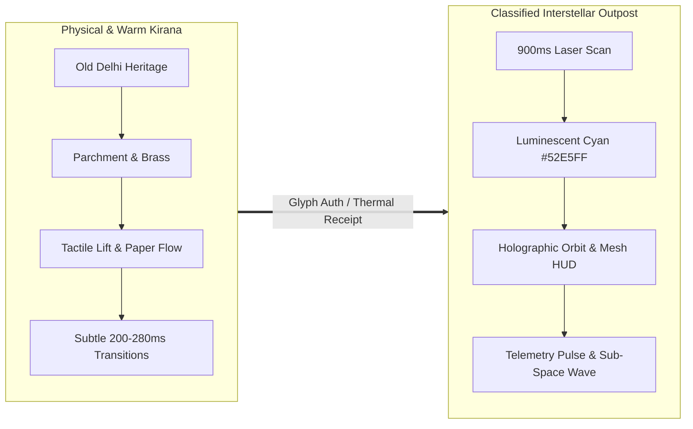
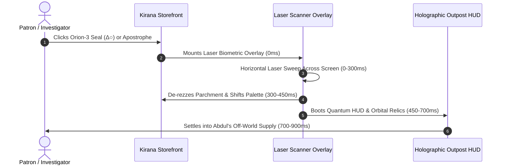

# ABDUL'S GENERAL STORE & OFF-WORLD SUPPLY
## Round 1 — Motion System, Transitions & 3D Immersion Specification

**Project**: Abdul's General Store & Off-World Supply  
**Version**: v0.5 (Phase 05: Motion & 3D Immersion Pass)  
**Competition Cards**:
- **Business**: Abdul General Store (Old Delhi Kirana store, Estd. 1979)
- **Theme**: Aliens (Interstellar resupply outpost #07 operated since October 1979)
- **Wild Card**: Add a Secret Feature (Organic anomaly discovery & 900ms scanline metamorphosis)

---

## 1. Motion Philosophy: Two Realities

---

## 2. Normal World: Physical Motion Choreography

### A. Staggered Hero Section Reveal
- **Header**: Downward translation `y: -8px -> 0px` (450ms, easeOut).
- **Badge**: `opacity: 0 -> 1`, `y: 12px -> 0px` (400ms, delay: 50ms).
- **Display Headline**: `opacity: 0 -> 1`, `y: 18px -> 0px` (450ms, delay: 100ms).
- **Narrative Copy**: `opacity: 0 -> 1`, `y: 14px -> 0px` (400ms, delay: 180ms).
- **CTAs (Shop / Heritage)**: `opacity: 0 -> 1`, `y: 12px -> 0px` (400ms, delay: 240ms).
- **Trust Badges**: Fade in (500ms, delay: 300ms).
- **Hero 3D Stage**: `scale: 0.96 -> 1.0`, `opacity: 0 -> 1` (550ms, delay: 150ms).

### B. Product Cards & Tactile Feedback
- **Hover State**: `translateY: -4px` with subtle shadow expansion (220ms, easeOut).
- **Image Scale**: Subtle scale from `1.0` to `1.05` with soft transform duration (500ms).
- **Active Click**: `scale: 0.98` on tap with immediate spring recovery.
- **Add to Basket Button**: Spring bounce with golden checkmark confirmation.

### C. Navigation Micro-Interactions
- **Category Nav Chips**: Smooth color interpolation with badge scale.
- **Wordmark Apostrophe Glyph**: On hover, scales by `1.15` with glowing cyan accent (`#52E5FF`) without blunt disclosure.

---

## 3. Anomaly Discovery System

| # | Anomaly Touchpoint | Normal Facade | Anomaly Motion & Feedback |
|---|---|---|---|
| **1** | **Heirloom Seeds** | *Desi Sabut Dhaniya* (₹80) | Sparkle badge rotates 45° on hover; `UNKNOWN` metadata triggers subtle amber underline. |
| **2** | **Cardamom Tea** | Black CTC Chai (₹145) | Barcode text glitches into `1420.405 MHz // [ORION-3]` on mouse enter. |
| **3** | **Thermal Delivery Receipt** | Neighbourhood invoice | Printed receipt slides upward; Orion-3 seal (`Δ○`) pulses with a 2-second breathing cycle and inverts 180° on hover. |
| **4** | **Wordmark Apostrophe** | `ABDUL'S` Wordmark | Microscopic inverted equilateral triangle glows and triggers biometric laser sweep. |

---

## 4. Canonical 900ms World Transformation

- **0–150ms**: Biometric scan ring initializes with terminal confirmation.
- **150–300ms**: Horizontal cyan laser sweeps vertically across the viewport.
- **300–450ms**: Background transitions from warm parchment (`#FFF9EF`) to cosmic void (`#070B18`).
- **450–700ms**: 3D hero stage reboots with Luminescent Cyan (`#52E5FF`) lighting and rotating wireframe mesh.
- **700–900ms**: Alien catalog locks in with Galactic Credits (`G₵`) and cargo payload mass ($kg$).

---

## 5. 3D Immersion & Inspection System

- **Dual-Mode Hero Stage (`StoreCounter3D.tsx`)**:
  - *Kirana Mode*: 1979 Brass Counter Lamp (`brass-lantern-3d`), 1420 MHz Radio (`retro-boombox-3d`), Vintage Astrolabe (`antique-camera-3d`).
  - *Secret Mode*: Orion-3 Pilot Relic (`cyber-helmet-3d`), Memory Seed Core (`brain-stem-3d`), Cargo Automaton (`cyber-xbot-3d`).
  - *Interactive Tools*: 360° orbit drag, auto-spin toggle, wireframe mesh HUD toggle, model selector tabs.
- **Interactive 3D Product Inspector (`ProductDetailModal.tsx`)**:
  - `[ 🖼️ Photo ]` vs `[ 🧊 3D Model ]` tab toggle mapped to authentic 3D models (`water-bottle-3d`, `fresh-avocado-3d`, `textured-box-3d`, `brass-lantern-3d`).
- **Holographic 3D Artifact Inspector (`AlienDetailModal.tsx`)**:
  - `[ 🧊 Hologram 3D ]` vs `[ 🖼️ Telemetry ]` toggle with full 360° orbit inspection.
- **Embedded Story Relic (`StoreStoryModal.tsx`)**:
  - Interactive 3D 1979 Brass Lamp embedded inside the narrative history.
- **Embedded Transceiver (`CommsManifestModal.tsx`)**:
  - 3D radio transmitter broadcasting the 1420.405 MHz sub-space carrier.

---

## 6. Accessibility & Performance Benchmarks

1. **Reduced Motion**: Respects `prefers-reduced-motion` for laser sweeps and transitions.
2. **Performance**: Built with native CSS transitions and Framer Motion hardware-accelerated transforms (`translate3d`, `scale`, `opacity`). Zero DOM node bloat.
3. **Build Verification**: Production build bundled cleanly in 18.82s with 0 errors.
