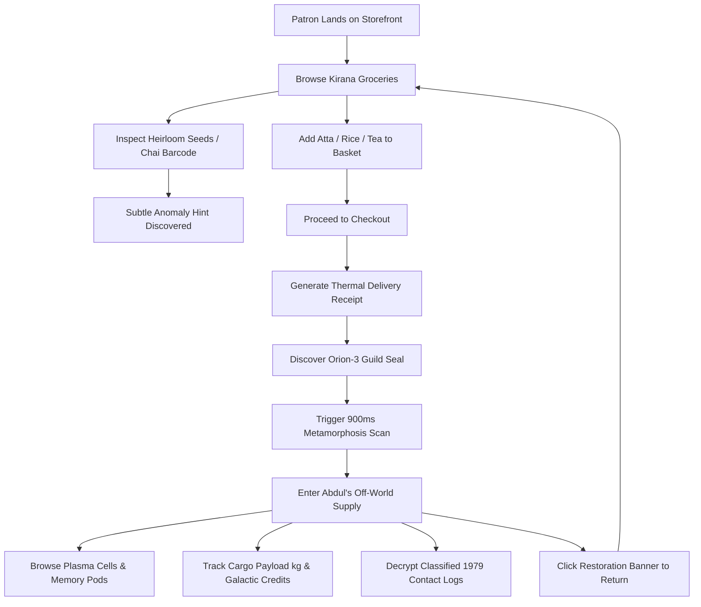
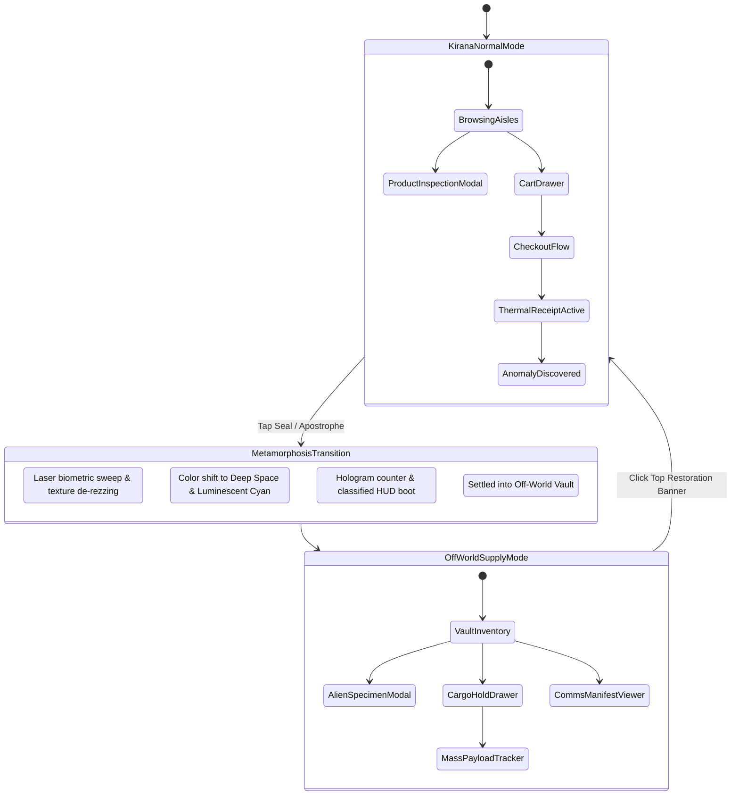

# ABDUL'S GENERAL STORE & OFF-WORLD SUPPLY
## UX Architecture, Discovery Loop & Interaction State Machines

**Competition**: Pixelcraft Armory 2026 — Round 1  
**Project**: Abdul's General Store & Off-World Supply  
**Cards Applied**:
- **Business**: Abdul General Store (Old Delhi Kirana store, Estd. 1979)
- **Theme**: Aliens (Interstellar resupply hub established October 1979)
- **Wild Card**: Add a Secret Feature (Organic anomaly discovery & 900ms scanline metamorphosis)

---

## 1. User Journey Architecture

---

## 2. The 4 Anomaly Discovery Touchpoints

| # | Anomaly Touchpoint | Normal Facade | Hidden Extraterrestrial Truth | Trigger Action |
|---|---|---|---|---|
| **1** | **Heirloom Coriander Seeds** | *Desi Sabut Dhaniya* (₹80) | Origin marked `UNKNOWN` (Field #X-09). Non-solar cultivation spectrum. | Click product or sparkle anomaly badge to inspect provenance. |
| **2** | **Malabar Cardamom Tea** | Black CTC Chai (₹145) | Barcode batch code displays `1420.405 MHz` (Hydrogen Line carrier frequency). | Hover or tap batch code in modal. |
| **3** | **Thermal Delivery Receipt** | Neighbourhood invoice in ₹ | Printed bottom seal reveals `TERRAN DISPATCH SEAL #07` with `Δ○` glyph. | Complete grocery checkout and click the glowing seal. |
| **4** | **Header Wordmark Glyphs** | `ABDUL'S` Wordmark | Microscopic inverted equilateral triangle inside apostrophe (`'`). | Click the red apostrophe in the header logo. |

---

## 3. Dual-Mode State Machine

---

## 4. Currency & Metric Transformation Table

| Metric | Abdul General Store (Kirana) | Abdul's Off-World Supply | Metaphor Alignment |
|---|---|---|---|
| **Primary Currency** | Indian Rupees (`₹`) | Galactic Credits (`G₵`) | Direct exchange rate calibrated for inter-galactic trade. |
| **Taxes & Levies** | 5% Neighbourhood GST | 0% Local (Guild Treaty Waived) | Autonomous consular supply charter. |
| **Inventory Metric** | Units (`kg`, `g`, `Litre`, `Packet`) | Units + Payload Mass (`kg`) | Ship cargo bay load-distribution limit (500kg max). |
| **Proprietor** | Abdul Rashid (Master Kirana Merchant) | Consular Agent Abdul-7 (Orion Sector Liaison) | Preserves identical personality & integrity. |
